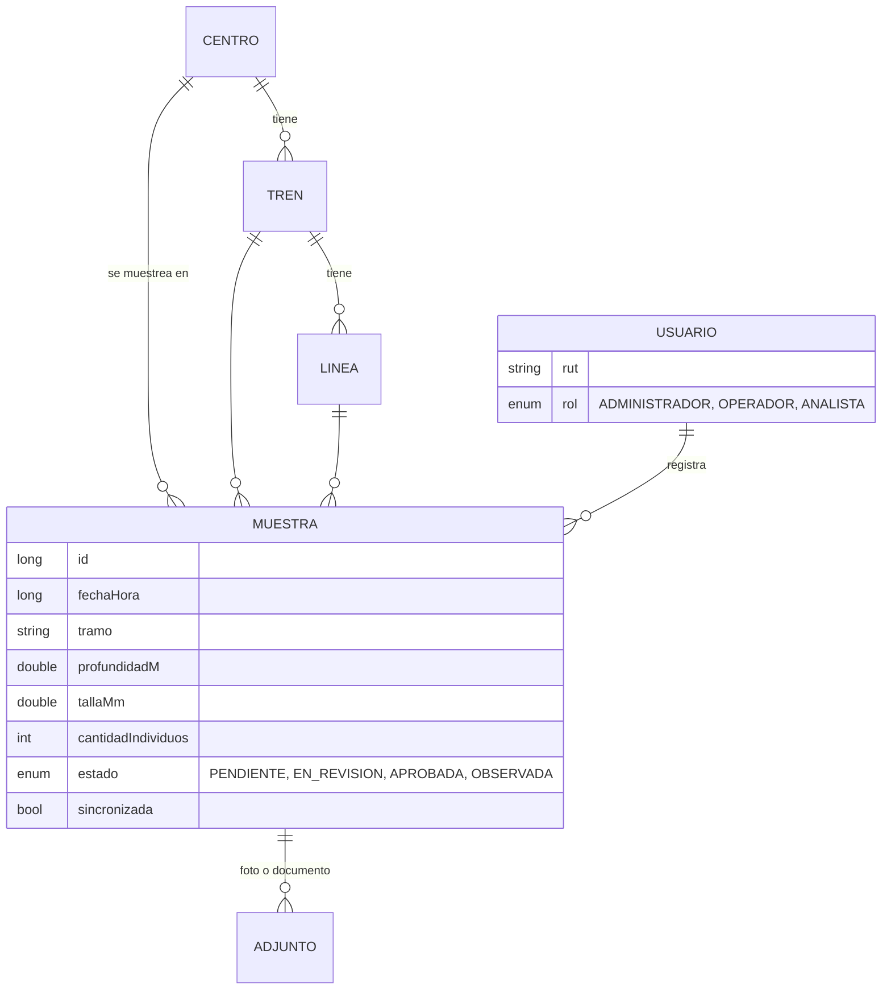
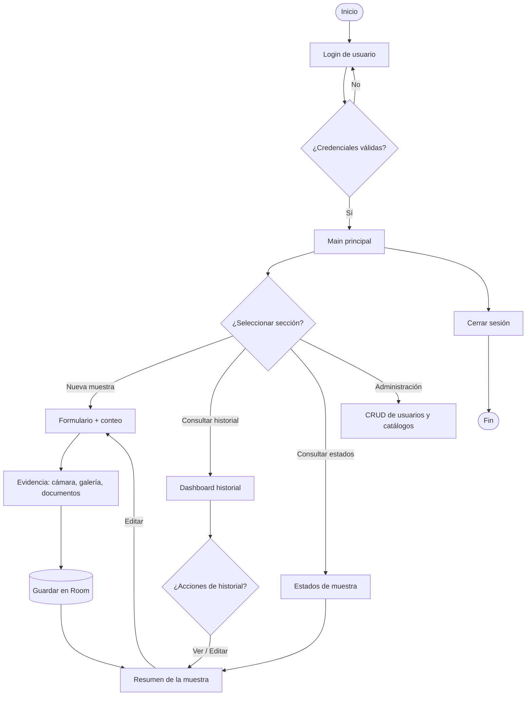

# AquaXor

Aplicación móvil Android (Kotlin + Jetpack Compose) para **registrar y contar choritos cultivados en el mar**.
El operador técnico registra la muestra en terreno (centro, tren, línea, tramo, fecha y hora), cuenta los
individuos, adjunta evidencia (foto, galería, documentos) y el analista revisa el historial y cambia el estado
de revisión. Proyecto académico DSY1105 · Equipo Dev-IA.

> **Datos ficticios.** Los usuarios, centros y muestras de demostración se crean automáticamente la primera vez
> que se abre la app. No se usa información real de trabajadores, clientes ni registros productivos.

## Cómo ejecutarlo

1. Abrir la carpeta `AquaXor` con **Android Studio Ladybug (2024.2) o superior**.
2. Esperar la sincronización de Gradle (descarga Gradle 8.9, AGP 8.7.3, Kotlin 2.0.21, Room 2.6.1).
3. Ejecutar en un emulador o celular con Android 8.0+ (API 26+).

| Rol | RUT (sin puntos ni guion) | Contraseña |
|---|---|---|
| Administrador | `111111111` | `admin123` |
| Operador técnico | `222222222` | `oper123` |
| Analista de reportes | `333333333` | `analista123` |

## Requisitos solicitados y dónde están

| Requisito | Implementación |
|---|---|
| Arquitectura MVVM | `model/`, `ui/screens/`, `viewmodel/` + `data/` (repositorio y Room) |
| Material 3 | `MaterialTheme` con la paleta del equipo, `Card`, `Button`, `FilterChip`, `ExposedDropdownMenu`, `DatePicker`, `TimePicker`, `Tab`, `Switch`… |
| Scaffold | Todas las pantallas; la principal usa `AppDrawerScaffold` (`ModalNavigationDrawer` + `Scaffold`) |
| Barras Material 3 | `TopAppBar` (todas), `ModalNavigationDrawer` (menú lateral), `BottomAppBar` con FAB (pantalla de evidencia), `FAB` naranja |
| Snackbar | `SnackbarHost` en cada `Scaffold`; los mensajes salen de `MessageBus` y se muestran desde un único colector en `AppNavGraph` |
| Navigation | `rememberNavController()` + `NavHost` + rutas en `ui/navigation/Ruta.kt` (con argumento `detalle/{id}`) |
| Estados con StateFlow | Todos los ViewModels exponen `StateFlow` y las pantallas usan `collectAsStateWithLifecycle()` |
| Filtros y búsquedas | Historial: texto libre + estado + rango de fechas + centro (consulta SQL en Room) |
| Persistencia Room / SQLite | `data/local/` (6 entidades, 4 DAO, claves foráneas) |
| Cámara | `TakePicture` + permiso `CAMERA` en tiempo de ejecución + `FileProvider` |
| Galería | `PickVisualMedia` (selector de fotos del sistema, sin permisos) |
| Documentos | `OpenDocument` para adjuntar PDF/planillas y `CreateDocument` para exportar el historial a CSV |
| Fecha y hora | `DatePickerDialog` y `TimePicker` de Material 3 en el formulario |
| Conexión a internet | `ConnectivityObserver` (`ConnectivityManager`) → `StateFlow<Boolean>`, aviso por Snackbar al cambiar y botón de sincronización que solo funciona en línea |

## Estructura

```
app/src/main/java/cl/aquaxor/app/
├── model/        Entidades Room (Usuario, Centro, Tren, Linea, Muestra, Adjunto), enums y resúmenes
├── data/
│   ├── local/        AquaDatabase + DAOs
│   ├── repository/   AquaRepository (única fuente de datos) y datos de demostración
│   ├── storage/      FileStorage (copia de fotos y documentos, FileProvider)
│   └── network/      ConnectivityObserver
├── viewmodel/    SessionViewModel, SampleViewModel, AdminViewModel, AquaViewModelFactory
├── ui/
│   ├── theme/        Paleta AquaXor
│   ├── components/   AppDrawerScaffold, MuestraCard, EstadoChip, CampoDropdown, diálogos…
│   ├── navigation/   Ruta + AppNavGraph
│   └── screens/      Login, Main, Form, Evidencia, History, Status, Detalle, Admin
└── util/         Formatos, Rut (dígito verificador), Seguridad (hash), Reporte (CSV)
```

## Modelo de datos



## Flujo de usuario

Diagrama de actividad original del equipo: `docs/diseno/flujo-usuario-uml.png`. Mockups: `docs/diseno/interfaces.png`.



## Permisos por rol

| Acción | Administrador | Operador técnico | Analista de reportes |
|---|:-:|:-:|:-:|
| Registrar muestra | ✔ | ✔ | — |
| Editar muestra | ✔ | ✔ | ✔ |
| Cambiar estado de revisión | todos | Pendiente / En revisión | todos |
| Historial, estados, exportar CSV | ✔ | ✔ | ✔ |
| Eliminar muestra | ✔ | — | — |
| CRUD de usuarios y catálogos | ✔ | — | — |

## Identidad visual

| Color | HEX | Uso |
|---|---|---|
| Azul Océano | `#004B87` | Barras, botones primarios |
| Naranja Boya | `#F26922` | FAB y acciones destacadas |
| Celeste Espuma | `#F4F8FB` | Fondo |
| Gris Pizarra | `#1C2833` | Texto |
| Verde Alga | `#27AE60` | Éxito / estados positivos |

## Alcance y limitaciones del MVP

- **Sincronización simulada:** aún no existe una API. El botón de sincronizar (historial) exige conexión a internet,
  espera 1,5 s y marca las muestras como sincronizadas. El punto de integración está en `SampleViewModel.sincronizar()`.
- **Autenticación local:** las contraseñas se guardan como hash SHA-256 con sal fija, adecuado para un MVP académico.
  Para producción se necesita autenticación en servidor.
- **Fotos:** se copian al almacenamiento privado de la app (`filesDir/adjuntos`), así el historial no depende de
  permisos de galería ni de que el archivo original siga existiendo.
- **Fuera de alcance (según Clase 1):** conteo automático por imágenes, dashboard estadístico avanzado, integración con
  sistemas externos y pruebas automatizadas.
