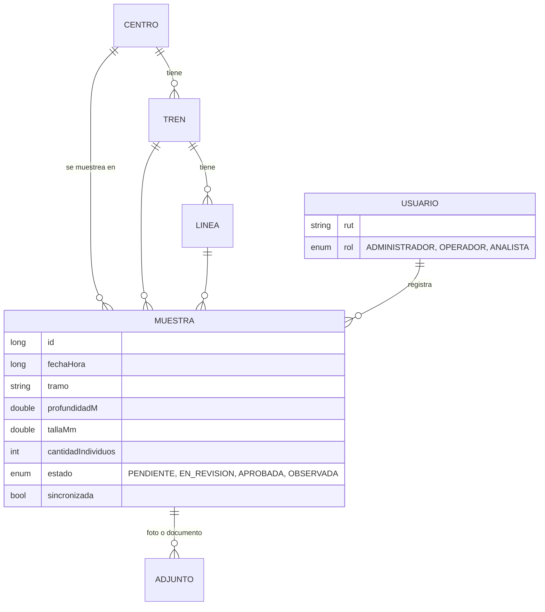
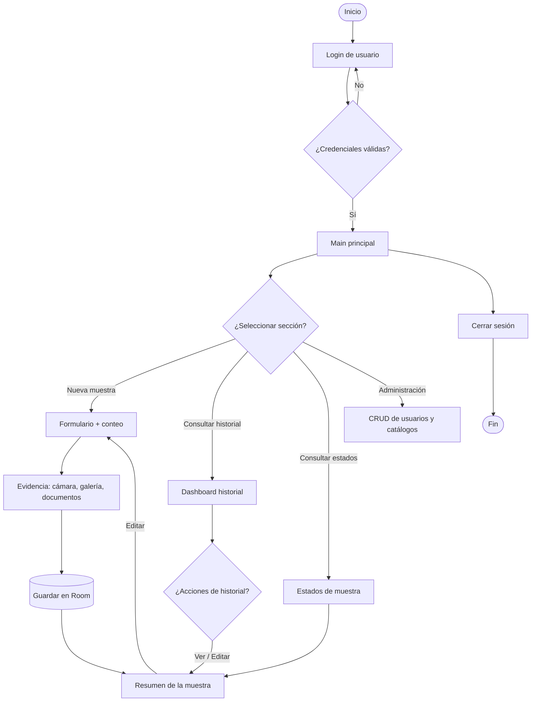

# AquaXor

Aplicación móvil Android (Kotlin + Jetpack Compose) para **registrar y contar choritos cultivados en el mar**.
El operador técnico registra la muestra en terreno (centro, tren, línea, tramo, fecha y hora), cuenta los
individuos, adjunta evidencia (foto, galería, documentos) y el analista revisa el historial y cambia el estado
de revisión. Proyecto académico DSY1105 · Equipo Dev-IA.

> **Datos ficticios.** Los usuarios, centros y muestras de demostración se crean automáticamente la primera vez
> que se abre la app. No se usa información real de trabajadores, clientes ni registros productivos.

## Cómo ejecutarlo

1. Abrir la carpeta `AquaXor` con **Android Studio Ladybug (2024.2) o superior**.
2. Esperar la sincronización de Gradle (descarga Gradle 8.9, AGP 8.7.3, Kotlin 2.0.21, Room 2.6.1).
3. Ejecutar en un emulador o celular con Android 8.0+ (API 26+).

| Rol | RUT (sin puntos ni guion) | Contraseña |
|---|---|---|
| Administrador | `111111111` | `admin123` |
| Operador técnico | `222222222` | `oper123` |
| Analista de reportes | `333333333` | `analista123` |

## Requisitos solicitados y dónde están

| Requisito | Implementación |
|---|---|
| Arquitectura MVVM | `model/`, `ui/screens/`, `viewmodel/` + `data/` (repositorio y Room) |
| Material 3 | `MaterialTheme` con la paleta del equipo, `Card`, `Button`, `FilterChip`, `ExposedDropdownMenu`, `DatePicker`, `TimePicker`, `Tab`, `Switch`… |
| Scaffold | Todas las pantallas; la principal usa `AppDrawerScaffold` (`ModalNavigationDrawer` + `Scaffold`) |
| Barras Material 3 | `TopAppBar` (todas), `ModalNavigationDrawer` (menú lateral), `BottomAppBar` con FAB (pantalla de evidencia), `FAB` naranja |
| Snackbar | `SnackbarHost` en cada `Scaffold`; los mensajes salen de `MessageBus` y se muestran desde un único colector en `AppNavGraph` |
| Navigation | `rememberNavController()` + `NavHost` + rutas en `ui/navigation/Ruta.kt` (con argumento `detalle/{id}`) |
| Estados con StateFlow | Todos los ViewModels exponen `StateFlow` y las pantallas usan `collectAsStateWithLifecycle()` |
| Filtros y búsquedas | Historial: texto libre + estado + rango de fechas + centro (consulta SQL en Room) |
| Persistencia Room / SQLite | `data/local/` (6 entidades, 4 DAO, claves foráneas) |
| Cámara | `TakePicture` + permiso `CAMERA` en tiempo de ejecución + `FileProvider` |
| Galería | `PickVisualMedia` (selector de fotos del sistema, sin permisos) |
| Documentos | `OpenDocument` para adjuntar PDF/planillas y `CreateDocument` para exportar el historial a CSV |
| Fecha y hora | `DatePickerDialog` y `TimePicker` de Material 3 en el formulario |
| Conexión a internet | `ConnectivityObserver` (`ConnectivityManager`) → `StateFlow<Boolean>`, aviso por Snackbar al cambiar y botón de sincronización que solo funciona en línea |

## Estructura

```
app/src/main/java/cl/aquaxor/app/
├── model/        Entidades Room (Usuario, Centro, Tren, Linea, Muestra, Adjunto), enums y resúmenes
├── data/
│   ├── local/        AquaDatabase + DAOs
│   ├── repository/   AquaRepository (única fuente de datos) y datos de demostración
│   ├── storage/      FileStorage (copia de fotos y documentos, FileProvider)
│   └── network/      ConnectivityObserver
├── viewmodel/    SessionViewModel, SampleViewModel, AdminViewModel, AquaViewModelFactory
├── ui/
│   ├── theme/        Paleta AquaXor
│   ├── components/   AppDrawerScaffold, MuestraCard, EstadoChip, CampoDropdown, diálogos…
│   ├── navigation/   Ruta + AppNavGraph
│   └── screens/      Login, Main, Form, Evidencia, History, Status, Detalle, Admin
└── util/         Formatos, Rut (dígito verificador), Seguridad (hash), Reporte (CSV)
```

## Modelo de datos



## Flujo de usuario

Diagrama de actividad original del equipo: `docs/diseno/flujo-usuario-uml.png`. Mockups: `docs/diseno/interfaces.png`.



## Permisos por rol

| Acción | Administrador | Operador técnico | Analista de reportes |
|---|:-:|:-:|:-:|
| Registrar muestra | ✔ | ✔ | — |
| Editar muestra | ✔ | ✔ | ✔ |
| Cambiar estado de revisión | todos | Pendiente / En revisión | todos |
| Historial, estados, exportar CSV | ✔ | ✔ | ✔ |
| Eliminar muestra | ✔ | — | — |
| CRUD de usuarios y catálogos | ✔ | — | — |

## Identidad visual

| Color | HEX | Uso |
|---|---|---|
| Azul Océano | `#004B87` | Barras, botones primarios |
| Naranja Boya | `#F26922` | FAB y acciones destacadas |
| Celeste Espuma | `#F4F8FB` | Fondo |
| Gris Pizarra | `#1C2833` | Texto |
| Verde Alga | `#27AE60` | Éxito / estados positivos |

## Versión 1.1.0 — mejoras

| Requisito | Dónde está |
|---|---|
| Retrofit + API de clima | `data/network/WeatherApi.kt` (Open-Meteo, sin clave), `WeatherRepository`, `ClimaViewModel`, `ui/components/ClimaCard.kt` |
| Base de datos en la nube (InsForge) | `data/network/InsForgeApi.kt`, `SincronizadorInsForge.kt`; tabla en `docs/insforge_schema.sql` |
| Pruebas unitarias (JUnit 5) y funcionales | `app/src/test/...` (lógica, Retrofit y sincronización con MockWebServer, ViewModel) |
| Pruebas de interfaz (Compose UI Test) | `app/src/androidTest/.../LoginScreenTest.kt` |
| Cobertura (Kover) | plugin `org.jetbrains.kotlinx.kover` en `app/build.gradle.kts` |
| APK firmada y versión | `signingConfigs` + `keystore.properties`; versión en `gradle.properties` (1.1.0, código 2) |
| Diseño: pantalla completa, cards, íconos, gráficos | `MainScreen`, `StatusScreen`, `MuestraCard` (miniatura), `ui/components/Graficos.kt` |

### Comandos (ejecutar en Android Studio > Terminal)

```
./gradlew testDebugUnitTest            # pruebas JUnit 5
./gradlew koverHtmlReportDebug         # reporte: app/build/reports/kover/htmlDebug/index.html
./gradlew connectedDebugAndroidTest    # pruebas de interfaz (emulador o celular conectado)
./gradlew assembleRelease              # APK firmada: app/build/outputs/apk/release/app-release.apk
```

En Windows (PowerShell) usa `.\gradlew` en vez de `./gradlew`. Si falla, usa el panel *Gradle* de Android Studio (Tasks > verification) o *Build > Generate Signed App Bundle / APK*
con el keystore de `keystore/aquaxor-release.jks` (alias `aquaxor`, claves en `keystore.properties`).
Ese keystore es solo para el proyecto académico: en uno real no se sube al repositorio.

### Configurar InsForge

1. Crea un proyecto en InsForge y ejecuta `docs/insforge_schema.sql`.
2. En `gradle.properties` completa `INSFORGE_URL` (por ejemplo `https://tu-app.insforge.app`) e `INSFORGE_KEY` (clave anónima o token).
3. Sincroniza Gradle. Sin esos valores la app funciona en modo local y el botón de sincronizar lo avisa.
La app envía `POST /api/database/records/muestras` con un arreglo JSON y cabecera `Authorization: Bearer ...`.

### Cambios de usabilidad (última revisión)

- Inicio: cada indicador es tocable y explica qué es (muestras, por revisar, individuos hoy, sin enviar a la nube).
- Formulario en una sola pantalla con fecha y hora de solo lectura (reloj en vivo), listas compactas y evidencia incluida.
- Historial: filtros por estado (color + ícono + cantidad) y por período (ícono + cantidad).
- Detalle de muestra: botón de descarga individual (CSV) e íconos en cada dato.

## Alcance y limitaciones

- **InsForge:** el envío es de una vía (dispositivo → nube); las muestras se insertan, no se actualizan.
- **Clima:** ubicación fija en Puerto Montt; requiere internet y muestra un mensaje si falla.
- **Cobertura:** Kover excluye pantallas Compose, Room y clases del framework; esas capas se cubren con las pruebas de interfaz.
- **Autenticación local:** las contraseñas se guardan como hash SHA-256 con sal fija, adecuado para un MVP académico.
- **Fotos:** se copian al almacenamiento privado de la app (`filesDir/adjuntos`).
- **Fuera de alcance:** conteo automático por imágenes y sincronización bidireccional.
